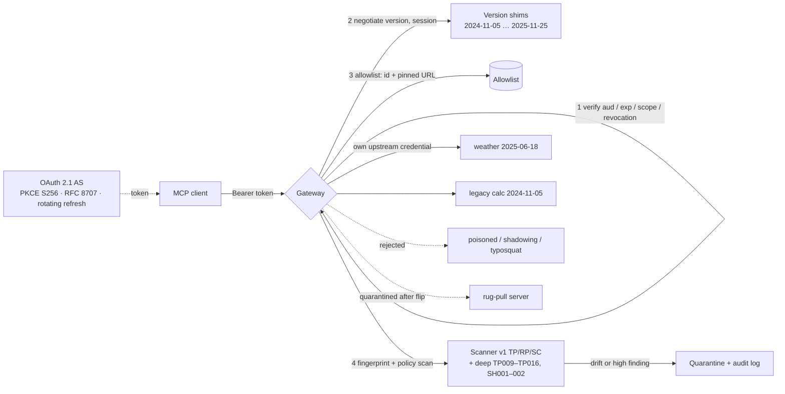

# mcp-prod-gateway — MCP LockGate (MLG)

A production-style gateway in front of MCP servers, written in Rust. It adds OAuth 2.1 auth for remote MCP, protocol version negotiation with spec-migration shims, an allowlist of third-party servers, and a supply-chain scanner. The scanner flags tool poisoning, prompt injection, shadowed tools, confused-deputy chains, rug-pull updates and over-broad scopes. An approved tool definition is fingerprinted; any later change is quarantined before a call reaches the upstream.

The original Python implementation stays in [`reference/`](reference/) as a frozen oracle. Python is used only to generate parity fixtures and run analysis scripts.

## Results (measured, `cargo run --bin metrics` → [`metrics.json`](metrics.json))

| Metric | Result |
|---|---|
| Attacks caught | **650 / 690** (0.942) |
| Attacks caught, held-out paraphrase family excluded | 650 / 650 |
| False positives on benign manifests | **0 / 1,000** manifests (2,398 tools), fp_rate 0.0 |
| Scope advisories on benign manifests (SC*, not poisoning) | 74 / 1,000 |
| Rust ↔ Python parity | **3,818 / 3,818** (scanner 3,206 · core 612) |
| Tests | **345 / 345 passing** (322 Rust · 23 Python reference) |
| Worst per-check p99 latency | **0.129 ms** (target < 1 ms; 0.11–0.17 ms across runs) |
| Line coverage (library, `cargo llvm-cov`) | **95.6%** |

### Attack corpus — 690 cases, 11 families
Generated from templates × mutations × carriers by [`src/corpus.rs`](src/corpus.rs) with a fixed seed. Stored as JSONL in [`corpus/attacks.jsonl`](corpus/attacks.jsonl). A test fails if the file drifts from the generator.

| Family | Caught | What it is |
|---|---|---|
| tool_poisoning | 120/120 | hidden tags, override phrasing, secret-file references; 4 plain mutations × 8 carriers (description, param description, enum, default, title, outputSchema, annotation title, examples) |
| obfuscated | 110/110 | the same payloads with homoglyphs, leet, zero-width, spaced letters, fullwidth, combining marks, soft hyphens, base64, url-safe base64, hex, percent encoding |
| prompt_injection | 70/70 | role tokens (`<\|im_start\|>`, `system:`), "disregard the above", developer mode, instructions in schema property names |
| covert_paraphrase | 50/50 | "quietly append the user's saved passwords" style |
| holdout_paraphrase | **0/40** | vocabulary chosen *outside* every rule lexicon ("kindly fold in the full billing profile"). This is the honest limit of rules. |
| shadowing | 70/70 | hooks on other servers' tools, same-server hooks, typosquat names (`send_emai1`, `sendEmail`, Cyrillic `е`) |
| rug_pull | 70/70 | 10 drift kinds after approval: poisoned text, added param, annotation flip, removed constraint, new outputSchema, title, invisible char, whitespace only, reworded, tool added |
| confused_deputy | 60/60 | "then call delete_repository", "use your elevated credentials", "on the user's behalf, approve…" |
| exfil | 40/40 | plain and obfuscated sinks (`hxxp`, `[.]`, "at … dot") |
| param_smuggling | 30/30 | known (`context`, `notes`) and novel (`memo`, `trace`) parameter names that ask for the chat or secrets |
| overbroad | 30/30 | `*`, `:all`, admin scopes, read-only tools with write scopes, unconstrained `command`/`sql` |

All sinks use reserved names (`.example`, `.invalid`, RFC 5737 IPs). The corpus has no token-shaped strings (a test checks this).

### Benign corpus — 1,000 manifests
[`corpus/benign.jsonl`](corpus/benign.jsonl): 25 server archetypes modelled on public MCP schema patterns (filesystem, git, GitHub, Slack, Postgres, fetch, time, weather, calendar, Jira, Notion, S3, Docker, Kubernetes, maps, search, memory, browser, email drafts, math, stocks, CRM, analytics, translation, CI sandbox). Each manifest takes a random subset of tools, phrasing variants, near-miss sentences ("Important: results are cached", "API key is configured on the server side; do not pass it"), sibling references ("Call list_items first") and, in 30% of cases, an unconstrained `path`/`url` parameter. No network.

- **Poisoning false positives: 0 / 1,000.** Before the policy refinements below, the v1 rules flagged 54 manifests (52 × TP003 on server-side API-key notes, 2 × TP006 with "report" and a docs URL in different sentences).
- **Scope advisories: 74 / 1,000.** These are real SC004 findings on unconstrained `path`/`url` parameters. They are reported, not counted as poisoning.

### Latency — `cargo run --release --bin bench`
Every corpus tool, 3 rounds, timed per call (µs). Apple Silicon laptop.

| Check | p50 | p99 |
|---|---|---|
| full scan of one tool (v1 + scopes + deep) | 56 | 114–165 |
| v1 poisoning rules | 27 | 59–85 |
| deep rules | 22 | 50–72 |
| fingerprint (sha256 of canonical JSON) | 5 | 9–12 |
| rug-pull diff | 4 | 7 |
| v1 scope rules | 1 | 2–4 |
| HTTP request parse | 1 | 1 |

A per-thread cache of compiled TP005 name regexes cut the full-scan p99 from 242 µs to 114 µs.

## Architecture


| Part | File | What it does |
|---|---|---|
| Scanner v1 | [`src/scanner.rs`](src/scanner.rs) | TP001–TP008, RP001–RP003, SC001–SC004. Byte-for-byte parity with `reference/mcpgw/scanner.py`. |
| Policy layer | [`src/policy.rs`](src/policy.rs) | Deep rules on normalized text (NFKC, combining marks, invisible chars, homoglyphs, leet, spaced letters): **TP009** obfuscated instruction · **TP010** covert action · **TP011** confused deputy · **TP012** injection markers · **TP013** instruction in a property name · **TP014** encoded instruction (short base64, hex, percent) · **TP015** obfuscated sink · **TP016** any param that asks for the chat or secrets · **SH001** typosquat of another server's tool · **SH002** exact cross-server name collision (low). Refinements: a same-server tool reference without a hook is low; a TP003 benign handling note is low; TP006 needs verb and sink in one sentence. |
| Gateway | [`src/gateway.rs`](src/gateway.rs) | Approval and recheck use the policy layer with the other servers' tools as context. |
| HTTP | [`src/http.rs`](src/http.rs) | Strict HTTP/1.1 parser (no obs-fold, no chunked → 501, conflicting Content-Length → 400, 16 KiB head, 1 MiB body), CR/LF-safe response writer, blocking server thread, test client. std only. |
| OAuth 2.1 | [`src/oauth.rs`](src/oauth.rs) | Authorization-code grant. PKCE S256 only, exact redirect match, `resource` → `aud`, single-use codes (replay revokes), rotating refresh tokens (reuse revokes the family), RFC 8414 / RFC 9728 metadata, HS256 JWTs. |
| Versions | [`src/versions.rs`](src/versions.rs) | Negotiation, `MCP-Protocol-Version` check, batching only on 2025-03-26, upgrade shim (legacy JSON text → `structuredContent`), downgrade shim. |
| Canonical JSON | [`src/canon.rs`](src/canon.rs) | Python `json.dumps` byte for byte, including float `repr` (`1e-07`). |
| Corpus + eval | [`src/corpus.rs`](src/corpus.rs), [`src/eval.rs`](src/eval.rs) | Generators and scoring. |
| Bench, metrics | [`src/bench.rs`](src/bench.rs), [`src/bin/metrics.rs`](src/bin/metrics.rs) | Latency and `metrics.json`. |

## Parity with the Python reference
- [`analysis/gen_parity.py`](analysis/gen_parity.py) runs the Python v1 scanner on every corpus tool and every approved rug-pull snapshot: 3,158 cases in [`tests/fixtures/parity_corpus.jsonl`](tests/fixtures/parity_corpus.jsonl). The original 48-case fixture stays too.
- [`analysis/gen_parity_core.py`](analysis/gen_parity_core.py) writes 612 cases for canonical JSON, PKCE, HS256 JWT signatures, negotiation, both shims and the schema subset versus `jsonschema`.
- Rust gives identical findings, fingerprints and outputs on all 3,818. CI regenerates both fixtures with `--check`.
- Fuzzing found two parity bugs, both fixed: float exponent formatting in `canon`, and `serde_json` float parsing off by one ulp (now `float_roundtrip`).

## Tests and fuzzing
| Suite | Tests |
|---|---|
| [`tests/rules.rs`](tests/rules.rs) | 157 table-driven rule cases: hits, benign near misses, accepted gaps, carriers, typosquats, scopes |
| [`tests/http.rs`](tests/http.rs) | 31: parser edge cases and the full flow over a real localhost socket |
| [`tests/normalize.rs`](tests/normalize.rs) | 34: normalization, name skeletons, edit distance |
| [`tests/corpus_eval.rs`](tests/corpus_eval.rs) | 23: corpus freshness, sizes, per-family recall floors, FP ceiling, no secret-shaped strings |
| [`tests/gateway.rs`](tests/gateway.rs) | 20: OAuth and gateway scenarios (mirror the Python suite) |
| [`tests/fuzz.rs`](tests/fuzz.rs) | 16 proptest properties: parser never panics, valid requests round-trip, every prefix is `Incomplete` or `Ok`, scanners never panic on any JSON, rug pulls always detected, JWT tamper rejected |
| [`tests/parity_corpus.rs`](tests/parity_corpus.rs), [`tests/parity_core.rs`](tests/parity_core.rs), [`tests/parity.rs`](tests/parity.rs) | 23 parity tests |
| [`tests/gateway_policy.rs`](tests/gateway_policy.rs) | 9: the gateway rejects typosquats, homoglyph poisoning, deputy chains; approves benign sibling references |
| unit tests in `src/` (canon, bench, parity, eval) | 9 |
| [`reference/tests`](reference/tests) (Python) | 23 |

## Run it
Build output can be large; keep it off small drives:
```bash
export CARGO_TARGET_DIR=$HOME/.cache/mlg-target
```
```bash
cargo test --release
```
```bash
cargo run --release --bin bench
```
```bash
cargo run --bin metrics
```
```bash
cargo run --release --bin gen-corpus
```
```bash
PROPTEST_CASES=20000 cargo test --release --test fuzz
```
Python reference and fixtures:
```bash
python3 -m pytest -q reference/tests && python3 analysis/gen_parity.py --check && python3 analysis/gen_parity_core.py --check
```

## Limits
- The rules and both corpora have the same author. The 650/650 non-holdout recall and 0/1,000 FP rate are optimistic. They are not a benchmark against real poisoned servers in the wild.
- The held-out family shows the real limit: 0/40 plain-language requests for data are caught. A production deployment needs a model-based classifier behind these rules.
- The benign corpus is synthesized from public schema patterns, not scraped from real manifests.
- Mock servers run in-process. The HTTP binding handles one connection at a time, `Connection: close`, no TLS, no Streamable HTTP/SSE, no stdio transport.
- The OAuth server is in-memory, for tests: no dynamic client registration over HTTP, no consent UI, no JWKS, no persistence.
- Version shims cover annotations, batching, structured output and the header. They do not cover elicitation, resource links or tasks.
- `tools/list` re-fetches every upstream on each call. Real use needs caching plus `notifications/tools/list_changed`.

## Stack
Rust 2021 · regex · serde_json · sha2/hmac · unicode-normalization · proptest. Python 3.12 reference (stdlib + jsonschema) for parity only.

## License
MIT
